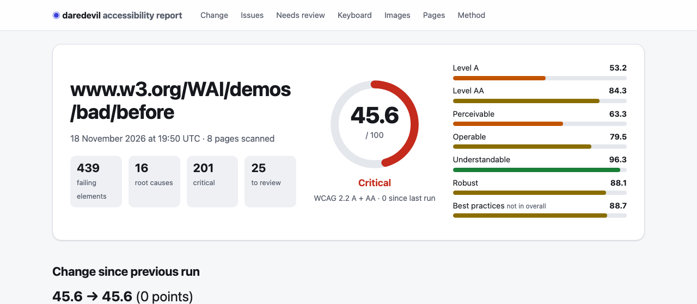
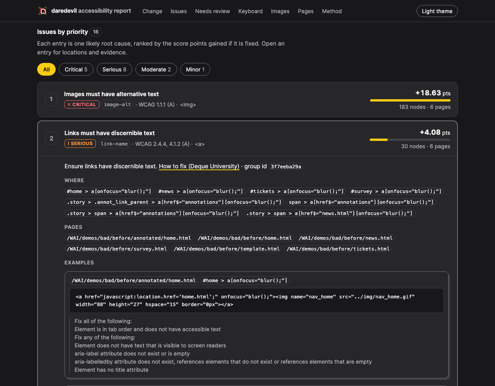

<p align="center"></p>

<h1 align="center">daredevil</h1>

**Accessibility audits you can measure, compare and hand to an AI to fix.**

Give daredevil a URL, optionally with a path (`https://www.mysite.com/shop`), and you get:

1. **A score from 0 to 100.** It is reproducible and fine-grained enough to show progress after each fix, and comparable between websites.
2. **An audit report** in two layers: a human-readable summary, and a structured list of anomalies grouped by root cause and ranked by impact.
3. **A ready-to-use fix prompt.** Paste it into an AI coding agent working in the site's codebase: it lists every defect with its evidence, groups them by category, and asks for one merge request per category, each verified by a re-audit.

daredevil has two parts:

| Part | What it does | Deterministic? |
|---|---|---|
| **Engine**: a TypeScript CLI ([Playwright](https://playwright.dev) + [axe-core](https://github.com/dequelabs/axe-core)) | Crawls the pages, runs the WCAG checks, scores, groups and writes `report.json`, `report.md`, `report.html` and `fix-prompt.md` | Yes. The score comes only from here |
| **Agent**: a Claude Code subagent (`.claude/agents/daredevil.md`) | Runs the engine, reviews what automation can't decide (alt-text quality, keyboard behaviour, undecided items) and returns `summary.md`, `assisted.json` and `handoff.md`, which the calling session writes and renders into `report.html` | No. It is AI judgement, kept separate from the score |

---

## Quick start

```bash
npm install
npx playwright install chromium
```

**With the agent** (in Claude Code, from this directory):

> daredevil, audit https://www.mysite.com/shop
>
> daredevil, I fixed the image alts, re-audit the shop and tell me if it improved
>
> daredevil, compare the accessibility of site-a.com and site-b.com

**Engine only:**

```bash
npm run -s audit -- https://www.mysite.com/shop --max-pages 25
```

```json
{
  "reportDir": "reports/www.w3.org_WAI_demos_bad_before/20261118-195027",
  "score": 45.6,
  "delta": 0,
  "comparableWithPrevious": true,
  "pagesScanned": 8,
  "pagesFailed": 0,
  "issueGroups": 16,
  "violationNodes": 439
}
```

### Scope

The URL's path bounds the crawl. daredevil starts at the URL and follows links breadth-first, staying inside the scope:

| Start URL | Audited | Not audited |
|---|---|---|
| `https://www.mysite.com/shop` | `/shop`, `/shop/cart`, `/shop/item/42` | `/shopping`, `/blog`, other domains |
| `https://www.mysite.com/shop/index.html` | the `/shop` directory, as above | |
| `https://www.mysite.com` | the whole site, up to `--max-pages` | |

Fragments (`#…`) and query strings are ignored for de-duplication; use `--keep-query` to keep query strings. Non-HTML resources (PDF, images…) are skipped. Redirects of the start URL (e.g. `mysite.com` to `www.mysite.com`) are followed before the scope is fixed. A page that redirects inside the scope, on the server or client-side (e.g. `/` routed to `/accueil`), is reported under its final URL; when that page was already scanned, the redirecting URL is listed as a skipped duplicate and does not count against `--max-pages`.

### Pages behind a login

To audit a customer area or a back office, save a login session once, then audit with it:

```bash
npm run -s login -- https://espace-client.orange.fr/
npm run -s audit -- https://espace-client.orange.fr/ --auth .auth/espace-client.orange.fr.json
```

- **You log in yourself**, in a visible browser window: captcha, SMS code and second factors work as usual, and daredevil never sees your credentials. The session is saved once you are back on the site after logging in (or press Enter, or close the window). In Claude Code, type `! npm run -s login -- <url>`.
- The session is the Playwright storage state (cookies and localStorage), saved to `.auth/<host>.json` with mode 0600. `.auth/` is git-ignored. Anyone with this file can use the account until the session expires: delete it when you are done.
- **Logout links are never followed** (`logout`, `sign-out`, `déconnexion`…), nor known account-changing flows (`retirer`, `confirmation`, `changer-iban`). Use `--exclude '<regex>'` for other links with side effects (cancel, delete, unsubscribe).
- **A lost session is detected.** A page that lands on a login page (another origin, or a `/login`-like path) is marked `auth-lost`, not scored, and the crawl stops after 2 in a row. Pass `--logged-in-check '<css>'` (for example the account menu) for a stricter check. Session cookies the site rotates during the crawl carry over to the next pages.
- **Personal data.** Account pages show names, addresses and contract numbers, which end up in HTML snippets. Image screenshots are therefore off by default (`--images` turns them on), and the reports carry a "Logged-in audit" warning. Review them before sharing.
- Logged-in runs are stored under `reports/<slug>_auth/`, so they are never compared with logged-out runs of the same URL.

---

## What you get

Each run writes to `reports/<site-and-path>/<timestamp>/`:

| File | Audience | Produced by |
|---|---|---|
| `report.json` | machines and AIs: the full structured result | engine |
| `report.html` | humans: a designed, self-contained report (score panel, filterable issues, AI findings, image gallery…), re-rendered with the agent's files | engine (`render`) |
| `report.md` | humans who want plain text: score, prioritised issues, evidence | engine |
| `fix-prompt.md` | an AI coding agent in the site's repo: a ready-to-paste prompt, one merge request per category (also in `report.html`, with a copy button) | engine (`audit` / `render`) |
| `assets/*.png` | element screenshots of images, for alt-text review | engine |
| `summary.md` | humans: a one-page executive summary | agent |
| `assisted.json` | machines: the agent's findings, with confidence levels | agent |
| `handoff.md` | an AI fixer: one task per root cause, with fix guidance and acceptance criteria | agent |

## Report samples

### HTML report

`report.html` is a single self-contained file (no external resources), with light and dark themes, a phone layout, and print styles. It is meant to be accessible itself: landmarks, a skip link, native disclosure widgets, and impact never conveyed by colour alone. Everything taken from the audited site is escaped.





Its design follows the project's [UX guidelines](docs/ux-guidelines.md): the logo's charcoal canvas and yellow corner-bracket focus rings, outlined status badges that pair every colour with an icon and a label, and offset "layer" cards for evidence. It has a light theme too, following the reader's OS setting, with a toggle.

It contains the score panel and breakdown, the agent's summary, the change since the last run, issues by priority (filterable by impact, each expandable to locations and evidence), the AI-assisted findings with their confidence, the undecided items, the keyboard probe, a gallery of image screenshots next to their alt text, and the page list.


The samples below are real output from auditing W3C's [Before and After Demonstration](https://www.w3.org/WAI/demos/bad/), a site built to be inaccessible on purpose, with a repaired "after" version (8 pages each).

### Score (`report.md`)

```markdown
## Score: 45.6 / 100

| Dimension | Score |
|---|---:|
| **Overall (WCAG A+AA)** | **45.6** |
| Level A | 53.2 |
| Level AA | 84.3 |
| Perceivable | 63.3 |
| Operable | 79.5 |
| Understandable | 96.3 |
| Robust | 88.1 |
| Best practices (not in overall) | 88.7 |

Violations: **439 nodes in 16 root-cause groups** (critical 201, serious 71, moderate 166, minor 1).
Needs review: 25 nodes in 7 groups.
```

### Issues by priority (`report.md`)

439 failing elements collapse into 16 root causes. They are ranked by **estimated score gain**: how many points the site would gain if that group were fixed.

| # | Gain | Impact | Rule | WCAG | Root cause | Nodes | Pages |
|---:|---:|---|---|---|---|---:|---:|
| 1 | +18.63 | critical | image-alt | 1.1.1 (A) | `` | 183 | 6 |
| 2 | +4.08 | serious | link-name | 2.4.4, 4.1.2 (A) | `<a>` | 30 | 6 |
| 3 | +2.74 | critical | select-name | 4.1.2 (A) | `<select>` | 7 | 6 |
| 4 | +2.38 | serious | target-size | 2.5.8 (AA) | `<a.page>` | 4 | 2 |
| 5 | +2.12 | serious | target-size | 2.5.8 (AA) | `<a.report>` | 12 | 6 |
| 6 | +1.25 | serious | color-contrast | 1.4.3 (AA) | `fg #41545d on bg #a9b8bf, 9.8pt (13px) bold` | 6 | 3 |
| 7 | +1.18 | serious | html-has-lang | 3.1.1 (A) | `page structure` | 6 | 6 |

Each group then gets a detail section with selector patterns, affected pages, HTML evidence and axe's failure summary:

````markdown
### 2. Links must have discernible text — `link-name` [3f7eeba29a]

- Impact: **serious** · WCAG 2.4.4, 4.1.2 (A) · operable
- Root cause: `<a>` · 30 nodes on 6 page(s)
- Where: `#home > a[onfocus="blur();"]`, `#news > a[onfocus="blur();"]`, `#tickets > a[onfocus="blur();"]`, …
- Pages: `/WAI/demos/bad/before/home.html`, `/WAI/demos/bad/before/news.html`, …

  - `/WAI/demos/bad/before/annotated/home.html` `#home > a[onfocus="blur();"]`
    ```html
    <a href="javascript:location.href='home.html';" onfocus="blur();"></a>
    ```

  Fix all of the following: / Element is in tab order and does not have accessible text / …
````

### Keyboard probe (`report.md`, heuristic, not scored)

| Page | Tab stops / tabbable | Skip link | No visible focus | Possible trap |
|---|---:|---|---:|---|
| `/WAI/demos/bad/before/home.html` | 12 / 56 | yes | 0 | `div#mnav > ul > li > a` |
| `/WAI/demos/bad/before/news.html` | 14 / 48 | yes | 0 | |

The probe tabs through each page. Here it found the demo's real defect: the navigation links call `onfocus="blur()"`, which throws keyboard focus away. Only 12 of the 56 tabbable elements are ever reached.

### One issue group (`report.json`)

Every group carries everything a fixing agent needs. Its `id` is stable across runs, so a fix can be verified by checking that the id disappears.

```json
{
  "id": "760a27b401",
  "ruleId": "color-contrast",
  "impact": "serious",
  "help": "Elements must meet minimum color contrast ratio thresholds",
  "helpUrl": "https://dequeuniversity.com/rules/axe/4.14/color-contrast?application=playwright",
  "wcag": ["1.4.3"],
  "level": "AA",
  "principle": "perceivable",
  "scored": true,
  "signature": "fg #41545d on bg #a9b8bf, 9.8pt (13px) bold",
  "occurrences": 6,
  "pageCount": 3,
  "pages": ["/WAI/demos/bad/before/annotated/home.html", "/WAI/demos/bad/before/home.html", "/WAI/demos/bad/before/template.html"],
  "patterns": ["tr[height=\"#px\"] > td[bgcolor=\"#A#B#BF\"][width=\"#px\"] > font[color=\"##D\"][size=\"#\"] > b"],
  "examples": [
    {
      "page": "/WAI/demos/bad/before/annotated/home.html",
      "selector": "tr[height=\"25px\"]:nth-child(2) > td[bgcolor=\"#A9B8BF\"][width=\"150px\"] > font[color=\"#41545D\"][size=\"2\"] > b",
      "html": "<b>Free Penguins</b>",
      "failureSummary": "Fix any of the following:\n  Element has insufficient color contrast of 3.88 (foreground color: #41545d, background color: #a9b8bf, font size: 9.8pt (13px), font weight: bold). Expected contrast ratio of 4.5:1",
      "data": { "fgColor": "#41545d", "bgColor": "#a9b8bf", "contrastRatio": 3.88, "expectedContrastRatio": "4.5:1", "fontSize": "9.8pt (13px)", "fontWeight": "bold" }
    }
  ],
  "estimatedScoreGain": 1.25
}
```

The top level of `report.json`:

```text
schemaVersion, tool {version, axeVersion, scoringVersion, browser}, generatedAt, config
summary      score breakdown, page counts, violation counts by impact
issues[]     violation groups, sorted by estimatedScoreGain
needsReview[] axe "incomplete" groups: undecidable automatically, not scored
pages[]      per page: score, raw violations, incomplete, passes, keyboard probe, images
```

### Before/after and benchmarking (`npm run diff`)

Comparing W3C's inaccessible demo with its repaired version:

```markdown
**Overall: 45.6 → 89.5 (+43.9)**

> ⚠️ page sets differ (8 only in before, 8 only in after); re-run with --same-pages for a strict comparison

| Score | Before | After | Δ |
|---|---:|---:|---:|
| overall | 45.6 | 89.5 | +43.9 |
| level A | 53.2 | 100 | +46.8 |
| level AA | 84.3 | 89.5 | +5.2 |
| perceivable | 63.3 | 100 | +36.7 |
| operable | 79.5 | 89.5 | +10 |
| understandable | 96.3 | 100 | +3.7 |
| robust | 88.1 | 100 | +11.9 |
| best-practice | 88.7 | 87.6 | -1.1 |

Issue groups: **10 fixed**, **1 new**, 1 changed in size.

Fixed:
- ✅ `image-alt`  (183 nodes)
- ✅ `link-name` <a> (30 nodes)
- ✅ `select-name` <select> (7 nodes)
- ✅ `color-contrast` fg #41545d on bg #a9b8bf, 9.8pt (13px) bold (6 nodes)
- ✅ `html-has-lang` page structure (6 nodes)
  …
New:
- ❌ `label-title-only` <select> (1 nodes, serious)
```

The repaired site still loses points. Its links fail WCAG 2.2's `target-size` (2.5.8), a criterion published after the demo was made.

When the same site is re-audited, this comparison is added automatically to `report.md` as "Change since previous run".

### Agent outputs

`assisted.json` holds findings the engine cannot score. Each has a confidence level so a fixer can weigh it:

```json
{
  "id": "A1",
  "category": "keyboard",
  "wcag": ["2.1.1", "2.4.7"],
  "impact": "serious",
  "confidence": "high",
  "page": "/WAI/demos/bad/before/home.html",
  "selector": "div#mnav > ul > li > a",
  "evidence": "Navigation links have onfocus=\"blur();\"; the keyboard probe reached only 12 of 56 tabbable elements",
  "recommendation": "Remove the onfocus blur handlers; style focus with :focus-visible instead of suppressing it"
}
```

`handoff.md` is written for an AI that will plan and apply the fixes. It contains:
1. **Context**: site, scope, score, file paths, and the verification command.
2. **Tasks**: one per issue group, in priority order. Each task has Where (patterns, pages), Evidence (HTML, failure summary), Fix guidance (specific to the evidence) and Done when (the group id is gone from a `--same-pages` re-run).
3. **Cautions**: fixes that probably belong in a design system, CMS content or a third-party widget, not in page markup.

### Fix prompt

`fix-prompt.md` is a self-contained prompt to paste into an AI coding agent working in the audited site's codebase. The engine writes it on every `audit` and `render` (so it includes the agent's `assisted.json` findings and appends `handoff.md` once they exist), and `report.html` shows it with a **Copy prompt** button.

It buckets every issue group and assisted finding into a fix category, and asks for **one merge request per category**, each on its own branch (`a11y/<category>`), independent of the others:

| Category | Branch | Typical rules |
|---|---|---|
| ARIA roles and attributes | `a11y/aria` | `aria-*`, `presentation-role-conflict` |
| Accessible names | `a11y/names` | `button-name`, `link-name`, `label-content-name-mismatch` |
| Form labels and inputs | `a11y/forms` | `label`, `autocomplete-valid`, `select-name` |
| Images and text alternatives | `a11y/images` | `image-alt`, `svg-img-alt`, assisted alt-text findings |
| Colour and contrast | `a11y/contrast` | `color-contrast`, `link-in-text-block` |
| Page structure and semantics | `a11y/structure` | `region`, `landmark-*`, `heading-order`, `list`, `html-has-lang` |
| Keyboard and focus | `a11y/keyboard` | `tabindex`, `nested-interactive`, `scrollable-region-focusable`, probe signals |
| Media, motion and timing | `a11y/media` | `video-caption`, `meta-refresh` |

Rules not listed fall back to their WCAG success criterion (see `src/fixprompt.ts`). Categories are ordered by total estimated gain. The prompt also sets the workflow (explore, plan and confirm, fix at the shared component or token, verify with a `--same-pages` re-audit), guard rails (fix the cause, never silence the checker; flag third-party and CMS items instead of patching them) and an MR title and description template.

**How the agent's files reach the disk.** Claude Code does not let subagents write report files, so daredevil returns its three deliverables as delimited blocks in its final message. The main session writes them into the report folder and runs `npm run -s render -- <reportDir>`, which folds them into `report.html` (see "When the daredevil subagent returns" in `CLAUDE.md`).

---

## Scoring model

The headline score covers the **WCAG 2.0 / 2.1 / 2.2, level A and AA** rules of axe-core.

```text
rulePenalty = weight(impact) × (1 + log2(failingNodes))     weights: critical 10, serious 5, moderate 2, minor 1
pageScore   = 100 × exp(−Σ rulePenalty / 100)
siteScore   = mean of the N lowest pageScores, N = max(ceil(10% of pages), 5)   (all pages if fewer than 5)
```

| Design choice | Why |
|---|---|
| Impact weights | One critical blocker costs as much as ten minor issues. |
| `log2` of node count | 200 broken buttons cost more than 1, but not 200 times more. Fixing half of them still moves the score, which keeps progress visible. |
| `exp(−P/100)` | A continuous 0–100 scale that never collapses to 0, so two bad sites can still be told apart. |
| Mean of the worst pages | The score describes the experience where it is worst. A plain mean over all pages rose with crawl depth: a deep crawl adds many simple pages that dilute defects on the main ones (one site went from 57 on 10 pages to 91 on 158 pages with identical page scores). The 5-page floor keeps small crawls from resting on a single page. Sub-scores use the same rule; the plain mean is still reported as `summary.score.mean`. |
| Best practices excluded | axe best-practice rules (`region`, `landmark-*`…) are not WCAG requirements. They get their own sub-score. |
| `needsReview` excluded | Undecided results are never counted as failures (no false positives in the score). |

Worked examples for a single page:

| Page state | Penalty | Score |
|---|---:|---:|
| No WCAG violation | 0 | 100 |
| 1 image without alt (critical, 1 node) | 10 | 90.5 |
| 4 low-contrast texts, same rule (serious, 4 nodes) | 5 × (1 + 2) = 15 | 86.1 |
| Both of the above | 25 | 77.9 |

Sub-scores use the same formula, restricted to one WCAG level or one POUR principle (Perceivable, Operable, Understandable, Robust).

**Comparability.** A score is only meaningful alongside the versions that produced it. Every report records the scoring version, the axe-core version (pinned in `package.json`), the browser, the viewport and the page list. `diff` warns when any of these differ.

## Root-cause grouping

Fix plans should target causes, not individual elements. Failing nodes are grouped by rule plus a signature:

| Kind of rule | Grouped by | Example signature |
|---|---|---|
| Page structure (`html-has-lang`, `document-title`, `region`, `landmark-*`, `bypass`…) | the rule alone | `page structure` |
| Colour contrast | foreground/background colour and font (≈ one design token) | `fg #41545d on bg #a9b8bf, 9.8pt (13px) bold` |
| Element with classes | tag + classes (≈ one component) | `<button.icon-btn>` |
| Element without classes | tag (+ role/type) | `<input[type=radio]>` |

The precise selector patterns of each group are kept in `patterns`, so the fixer knows where to look. Changing these rules changes group ids. That breaks diffs across the change, so note it when you do.

## Measuring improvement and benchmarking

- **After a fix:** re-run with `--same-pages`, so the crawl can't drift (new products, changed links) and blur the comparison:
  ```bash
  npm run -s audit -- https://www.mysite.com/shop --same-pages reports/www.mysite.com_shop/<timestamp>/report.json
  ```
- **Between sites:** use the same options for each (`--max-pages`, viewport), then compare `summary.score`. Comparing the same section type (e.g. `/shop` against `/shop`) is fairer than comparing whole sites.
- **Determinism:** pages load with reduced motion, a fixed viewport, `networkidle` plus `--wait-ms` of settle time, and a fresh browser context per page. Highly dynamic pages (A/B tests, rotating banners) can still vary slightly between runs.
- **Cookie-consent dialogs** are dismissed before scanning, the way a privacy-minded user would: "reject" or "continue without accepting", never "accept". Known consent tools (Didomi, OneTrust, Cookiebot, Axeptio, tarteaucitron, Usercentrics…) are detected, with a text-based fallback in French and English. Without this, the dialog covers the page: the keyboard probe gets stuck in it and screenshots show it. Use `--consent-selector` when a dialog isn't recognised, and `--keep-consent` to audit the dialog itself. Runs with different consent handling are flagged as not comparable.

## CLI reference

```text
npm run -s audit -- <url> [options]
  --max-pages <n>        Max pages to scan (default 25)
  --concurrency <n>      Parallel pages (default 2)
  --viewport <WxH>       Viewport (default 1280x800)
  --wait-ms <ms>         Extra settle time after load (default 1000)
  --timeout <ms>         Navigation timeout (default 30000)
  --user-agent <ua>      Override the browser user agent
  --keep-query           Treat ?query variants as distinct pages
  --same-pages <json>    Re-scan exactly the pages of a previous report.json
  --skip-best-practice   Do not run axe best-practice rules
  --keep-consent         Do not dismiss cookie-consent dialogs (audit them as shown)
  --consent-selector <s> CSS selector of the consent 'reject' button, if not auto-detected
  --skip-keyboard        Skip the keyboard probe
  --skip-images          Skip image screenshots for alt-text review
  --exclude <regex>      Never visit URLs matching this (case-insensitive; repeatable)
  --auth <file>          Audit logged in, with a session saved by 'login'
  --logged-in-check <s>  CSS selector visible only when logged in (stricter session check)
  --images               With --auth: capture image screenshots anyway
  --out <dir>            Reports root (default ./reports)

npm run -s login -- <url> [options]  open a browser, log in by hand, save the session
  --out <file>           Session file (default .auth/<host>.json)
  --logged-in-check <s>  Save as soon as this selector is visible
  --wait <minutes>       Give up after this long (default 10)

npm run -s diff -- <before/report.json> <after/report.json>
npm run -s render -- <reportDir>     rebuild report.md / report.html with the agent's files
```

**User agent.** Many sites reject headless browsers (W3C returns HTTP 403). By default daredevil sends the regular Chrome user agent plus a `daredevil-a11y/0.1` token, so it stays identifiable in server logs. Audit only sites you are allowed to crawl, and keep `--concurrency` low on production sites.

## Limits

- Automated rules detect only part of WCAG failures: Deque estimates about 57% by volume, and fewer by number of success criteria. A score of 100 means **no detectable violation**, not WCAG conformance.
- The keyboard probe and the alt-text review are heuristics or AI judgement. They are reported with confidence levels and never scored.
- Logged-in audits reuse a session you create by hand; scripted logins (for CI) are not supported yet. Pages reached only by clicking (no `<a href>`) are not crawled.
- Not covered yet: screen-reader behaviour, multi-step flows (checkout, forms), mobile viewports in a single run, PDFs.

A conformance claim still needs manual testing with assistive technologies.

## Development

```bash
npm test            # unit tests + an end-to-end audit of test/fixtures/site
npm run typecheck
```

```text
src/cli.ts       arguments, report directory, automatic comparison with the previous run
src/crawl.ts     URL normalisation and scope
src/audit.ts     browser, breadth-first crawl, axe scan, conversion of axe results
src/probes.ts    keyboard probe, image inventory and screenshots
src/group.ts     root-cause signatures and grouping
src/score.ts     scoring model (bump SCORING_VERSION on any change)
src/report.ts    report.json assembly, diff, markdown rendering
src/html.ts      HTML report
src/auth.ts      login session capture and loading, login-page and logout-link detection
src/consent.ts   cookie-dialog dismissal
src/brand.ts     logo embedding (assets/logo.svg)
.claude/agents/daredevil.md   the Claude Code agent
```

Any UI work follows [`docs/ux-guidelines.md`](docs/ux-guidelines.md), including its verified contrast notes. See `CLAUDE.md` for the project's rules: the scoring versioning, and the constraint on code run inside the browser.

## License

[MIT](LICENSE) © 2026 Yves Christol
